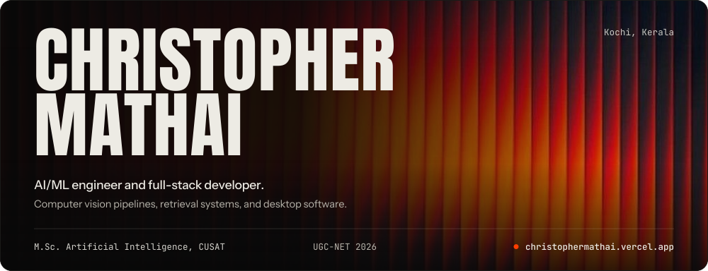
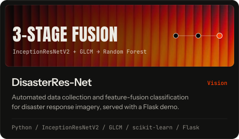
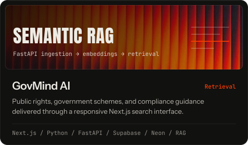
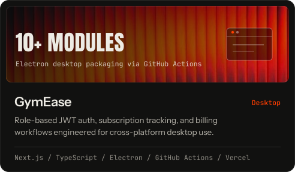
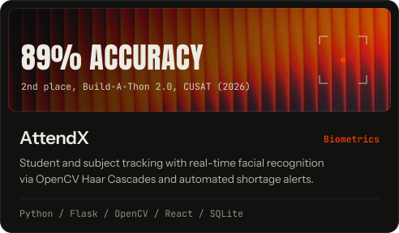
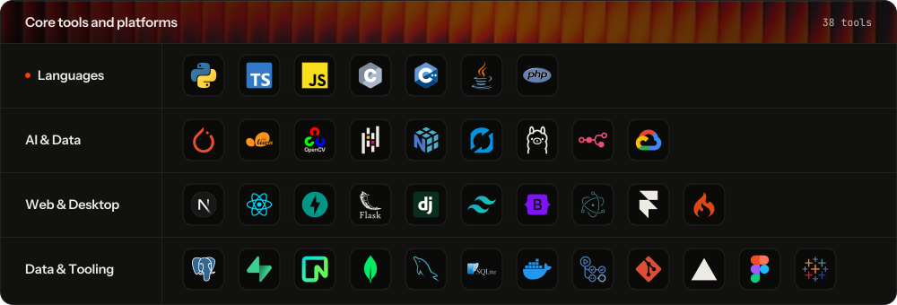
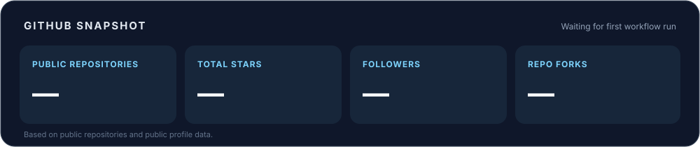

<!--
  Christopher Mathai — GitHub Profile README
  https://github.com/Christophermathai/Christophermathai
-->

<picture>
  <source media="(prefers-color-scheme: dark)" srcset="assets/profile-dark.svg">
  
</picture>

  <a href="https://christophermathai.vercel.app/">Portfolio</a> &nbsp;/&nbsp;
  <a href="https://github.com/Christophermathai?tab=repositories">Repositories</a> &nbsp;/&nbsp;
  <a href="mailto:christophermathai123@gmail.com">christophermathai123@gmail.com</a>

Computer Science postgraduate specializing in Artificial Intelligence at CUSAT, Kochi. I build machine learning pipelines, semantic retrieval systems, and full-stack applications with Python, TypeScript, Next.js, and FastAPI.

## Selected work

  
  

  
  

## Technical stack

## Experience

**AI Engineer Intern**, Aurenza AI *(Jun – Oct 2026)* 
Architected 6+ production features, including AI-powered takeout ordering, restaurant booking automation, menu-intent recognition, and customer-pronunciation handling. Designed four management modules, including a restaurant admin portal and a neighboring-table connectivity system.

**Data Analyst Intern**, Unified Mentor Pvt. Ltd. *(May – Jul 2025)* 
Analysed four industry datasets covering COVID-19 clinical trials, Coca-Cola stock forecasting, web-threat detection, and EV sales across Indian states using Python for cleaning, exploratory analysis, and predictive modelling.

**Web Development Intern**, Megatrend Knowledge Management Systems Pvt. Ltd. *(Apr – May 2024)* 
Delivered production web modules in PHP and JavaScript across sprint cycles and code reviews.

## Education and recognition

- **M.Sc. Computer Science (Artificial Intelligence)**, CUSAT, Kochi *(2025 – 2027, CGPA 8.0)*
- **Bachelor of Computer Applications**, RCMAS, Kakkanad *(2022 – 2025, CGPA 8.0)*
- **UGC-NET qualified**, Computer Science and Applications *(2026)*

**Competitions and research**
- 1st place, Code Crafters at CASCADE *(2025)*
- 2nd place, Build-A-Thon 2.0 at STACC, CUSAT *(2026)*
- 3rd place, CommitX at Christ University, Bangalore *(2026)*
- 2nd place, Binary Brainstorm at TecXell *(2024)*
- Presented research on AI-powered Medical Robotics at ICAET *(2025)*

**Certifications**
- Generative AI, Microsoft *(May 2025)*
- MERN Stack Development, Paatshala at ICT Kerala *(2026)*
- Excel Data Analysis, NASBA *(March 2025)*

 

